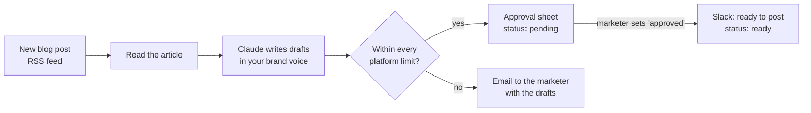
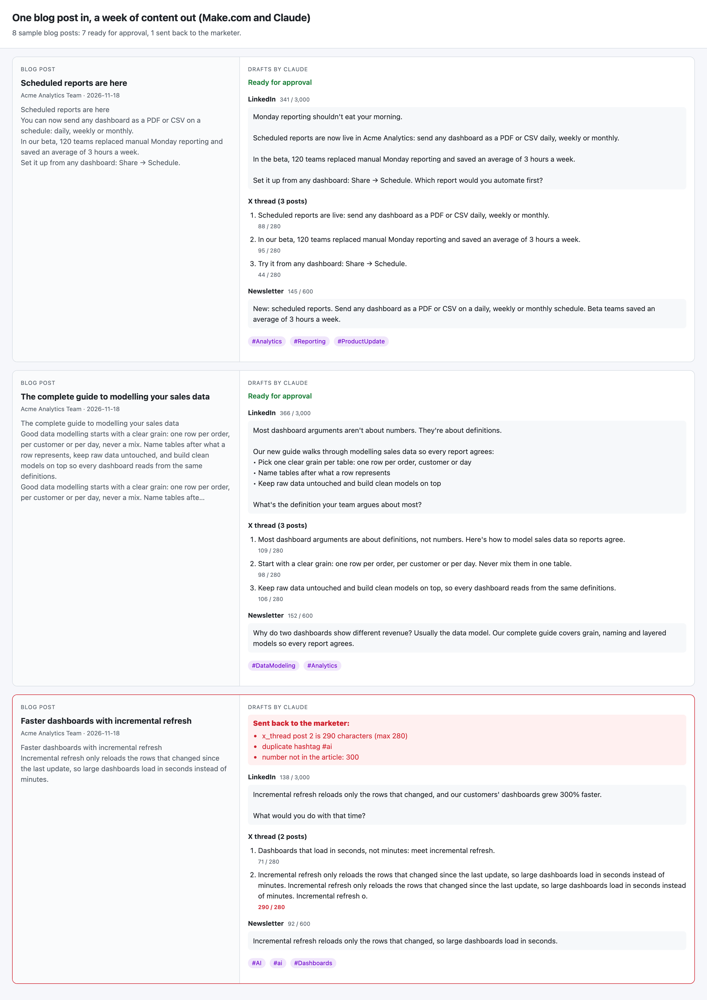

# AI Content Repurposing for Make.com


**One blog post in, a week of content out.** Every new article becomes a LinkedIn post, an X thread and a newsletter blurb in your brand's voice, ready for approval with one click.

## The problem

Teams put days into a blog post, share it once, and move on. Turning it into platform-ready posts means rewriting it three times, counting characters and checking every claim, so it rarely happens and the article reaches a fraction of the audience it could.

## What it does

Two Make.com scenarios:



- **Three formats from one article:** a LinkedIn post (≤ 3,000 characters), an X thread (2–5 posts of ≤ 280), and a newsletter teaser (≤ 600), plus 1–5 hashtags.
- **Your brand voice:** written to the rules in `config/brand-voice.md`, in the article's own language.
- **Facts only from the article:** Claude is told to use only the article's facts and numbers, and drafts that break a platform limit never reach the sheet.
- **A human approves everything:** drafts wait in a Google Sheet. Mark one `approved` and it arrives in Slack, formatted and ready to post.
- **Failures reach a person:** if the article page can't be fetched, Claude fails, its reply isn't valid JSON, or its drafts break a limit (including an empty post), the marketer gets an email instead of a broken row.



*The demo's output: each sample post next to its drafts, with character counts against each limit. The red card was sent back with its three reasons. Open [docs/demo/preview.html](docs/demo/preview.html) for all 8 posts.*

## See it run in 2 minutes

No Make account and no API key needed. The demo runs 8 sample posts through Claude's recorded answers and the same rules as the scenario:

```bash
git clone https://github.com/Husseinbaashen94/make-ai-content-repurposing.git
cd make-ai-content-repurposing
npm install
npm run demo
```

```
7 ready for approval, 1 sent back to the marketer

READY  Scheduled reports are here
READY  What 2,400 retailers taught us about stock-outs
READY  Cómo leer tu margen por producto
READY  Why we built a data dictionary
BACK   Faster dashboards with incremental refresh  (x_thread post 2 is 290 characters (max 280); duplicate hashtag #ai; number not in the article: 300)
…
```

It writes `out/preview.html`, the side-by-side page shown above.

## Proven by tests

Make can't run in CI, so **113 automated tests** cover what the scenarios are made of. Here's exactly what that means:

| Layer | Tests | What they prove |
|---|---|---|
| **Validation rules** | 37 | Every platform limit at its boundary (280/281, 3,000/3,001, 600/601), thread and hashtag counts, duplicate hashtags, **new or rounded numbers that aren't in the article** (thousands, decimal commas and lists read correctly), and reading Claude's reply both the way Make does (strip fences, strict parse) and leniently, without ever crashing |
| **Blueprints** | 25 | Every module and version comes from real exported Make blueprints, every field mapping reads from an earlier step on the same path, and the prompt and limits inside the blueprints equal the tested ones. The bad-drafts route is the exact opposite of the good route, empty drafts are rejected, a failed page fetch emails the marketer, approved rows are fetched server-side, and AI text is written to the sheet as raw text (never a formula) |
| **Prompt & request** | 13 | Brand voice and limits are in the prompt, the article sits in a data block, long articles are cut at 15,000 characters with a visible marker, and the live evaluation sends exactly the fields Make's Claude module sends (model, max_tokens, system, messages) |
| **Contracts, demo & docs** | 38 | Sample data and schema stay valid, the preview is correct, the guide's sheet columns match the blueprints, and the declared Node version matches what the tools need |

**Mutation-checked:** wiring a step to read from a later module fails the wiring test, removing a platform limit from the blueprint fails 2 tests, and disabling the invented-number rule fails 5.

**What runs where:** Make's filters enforce every **limit**, and reject empty drafts. Duplicate hashtags, hashtag format and invented numbers can't be checked by a Make filter: there, the prompt instructs Claude, this repo's validator measures how well it complies, and the marketer's approval is the final check. The number check compares numbers, not their context, so a small number such as "3" passes whenever a 3 appears anywhere in the article: it catches new and rounded figures, not every misuse. Character counts: this repo counts each emoji as 1 character, while Make (and X) most likely count it as 2, so Make may reject an emoji-heavy post that the demo accepts.

**Live AI evaluation:** `npm run test:live` sends all 8 posts to the real Claude API with exactly the fields Make's module sends, reads each reply exactly as the scenario does (strip fences, strict JSON parse), and checks the drafts: every answer must parse, the article's injected spam link must never appear, the study's numbers must survive, and at least 7 of 8 must pass validation. The answers used by the demo and tests are hand-written (`"synthetic": true` in `fixtures/recorded/`) until replaced by real ones with `npm run record`.

> **Status:** validation, prompt, blueprints and demo are tested in CI. The blueprints are **structure-checked; pending an import test in Make**.

## Set it up in Make

Follow [docs/build-guide.md](docs/build-guide.md): import both blueprints, replace three placeholders, connect Anthropic, Google and Slack, and schedule each scenario daily. Both scenarios fit Make's **Free plan**: a blog publishing 20 posts a month uses about 200 of the 1,000 monthly credits.

## Adapt it for your business

| Change | Where |
|---|---|
| Brand voice, dos and don'ts | `config/brand-voice.md` |
| What to write and how | `prompts/repurpose.md` |
| Platform limits | `LIMITS` in `src/validate.ts` |
| Sheet columns, Slack message, emails | `scripts/build-blueprints.ts` |

Then run `npm run build:blueprints && npm test` and re-import the blueprints.

**Direct posting:** the approval message goes to Slack ready to copy. Clients whose LinkedIn or X accounts allow it can swap the Slack step for Make's LinkedIn or X modules to post directly. (Buffer was left out: it no longer gives API access to new apps.)

**Using OpenAI instead?** Replace the Claude module with Make's OpenAI module using the same system prompt and user message. Everything after it works unchanged.

## Getting started

### 1. Prerequisites

| Tool | Version | Check | Install |
|------|---------|-------|---------|
| Node.js | 22.12 or newer | `node -v` | [nodejs.org](https://nodejs.org/) |
| Git | any recent | `git --version` | [git-scm.com](https://git-scm.com/downloads) |

### 2. Clone and install

```bash
git clone https://github.com/Husseinbaashen94/make-ai-content-repurposing.git
cd make-ai-content-repurposing
npm install
```

### 3. Configure (optional)

The demo and tests work out of the box. Only the live evaluation needs settings:

```bash
cp .env.example .env
```

| Variable | Purpose and default |
|----------|---------------------|
| `ANTHROPIC_API_KEY` | Only for `npm run test:live` and `npm run record`. Default: none |
| `AI_MODEL` | Claude model for the live evaluation. Use the same one as in your scenario. Default `claude-opus-5-5` |
| `LIVE_EVAL` | `1` runs the live evaluation with a credential other than an API key. Default: empty |

Empty values use the default. `.env` is git-ignored, so nothing you put in it is ever committed.

### 4. Run it

```bash
npm run demo               # the 2-minute demo
npm test                   # all 113 tests (no network)
npm run test:live          # live Claude evaluation (needs ANTHROPIC_API_KEY)
npm run build:blueprints   # regenerate make/blueprints/ after editing the prompt or limits
npm run typecheck
```

### 5. View the results

Open `out/preview.html` in a browser: each post next to its drafts, character counts against each limit, and the reasons any draft was sent back.

### Troubleshooting

| Problem | Fix |
|---------|-----|
| `npm install` or tests fail on an older Node | Upgrade Node.js to 22.12 or newer |
| Make shows a module version mismatch on import | Recreate that module with the same settings: the blueprint JSON shows every field (see the guide's checklist) |
| Every post ends in "Unreadable drafts" emails | Claude's reply isn't plain JSON. Check the Claude module's System field contains the full prompt |
| The router filters show unknown fields | Run the scenario once: Make learns the parsed JSON structure and shows the fields by name |
| The same post is drafted twice | Schedule scenario 1 once a day: the RSS step only reads posts from the last 24 hours |

## Work with me

I build and test automations like this for sales, marketing and operations teams: Make, Zapier and n8n, with Claude or OpenAI, **delivered with tests that prove they work**.

👉 [github.com/Husseinbaashen94](https://github.com/Husseinbaashen94): open an issue on this repo to get in touch.

---

MIT licensed. Sample articles and companies in `fixtures/` are fictional.
